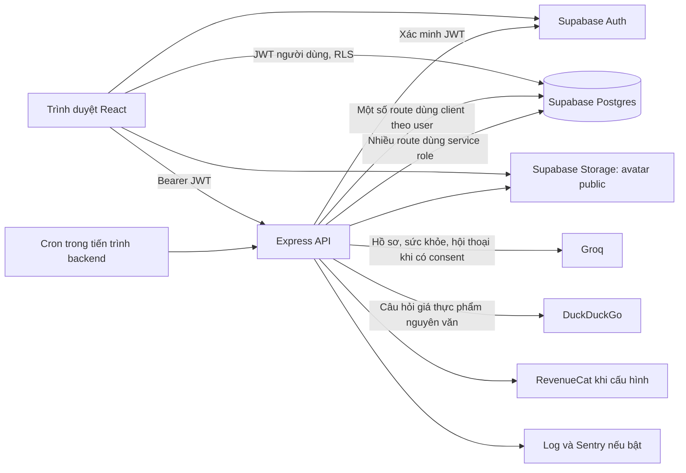

# Fitly: rà soát dữ liệu, bảo mật, quyền riêng tư và khả năng phục vụ 1.000 người dùng

Ngày kiểm tra: 26/10/2026 (Asia/Ho_Chi_Minh). Mã nguồn: commit `05f78a1`.

**Ghi chú sau audit:** báo cáo này giữ nguyên bằng chứng trước khi sửa. Các thay đổi và điều kiện triển khai được theo dõi trong [bản bàn giao hardening](hardening-release-2026-10-26.md).

## Kết luận và phạm vi

Fitly có nền tảng phù hợp để tiếp tục phát triển thành sản phẩm cho 1.000 tài khoản. Tuy nhiên, chưa đủ bằng chứng để xác nhận sẵn sàng vận hành ở quy mô đó. Cần sửa các lỗi về quyền lợi/quota, tính toàn vẹn dữ liệu và chia sẻ dữ liệu trước khi mở rộng người dùng.

Rà soát này gồm Frontend, Backend, shared, migrations Supabase, CI, tài liệu vận hành; chạy kiểm tra local và một số GET/HEAD không đăng nhập trên hai địa chỉ triển khai được ghi trong repo. Không thay đổi dữ liệu production, không thực hiện khai thác trên tài khoản thật, không chạy tải lên production. Mobile chỉ được xem trong phạm vi hạ tầng và dữ liệu dùng chung.

Các phát hiện SQL dưới đây được xác định từ migrations đã commit; chưa xác nhận database production đang có đúng toàn bộ quyền/policy đó. Không có quyền quản trị cloud trong phạm vi kiểm tra này, nên backup, region, SMTP, MFA, hạn mức nhà cung cấp và cấu hình Auth thực tế còn chưa được xác minh. Đây là rà soát kỹ thuật, không phải kết luận tuân thủ pháp luật.

**Mức ưu tiên:** P1 = sửa trước khi mở rộng công khai; P2 = hoàn thiện trong đợt chuẩn bị vận hành. Những mục chỉ thiếu bằng chứng được ghi rõ, không coi là lỗi đã xảy ra.

## Bản đồ luồng dữ liệu

| Luồng | Hiện trạng | Điểm cần cải thiện |
| --- | --- | --- |
| Đăng ký/đăng nhập/khôi phục | Trình duyệt gọi Supabase Auth; API xác minh token | Kiểm tra cấu hình production; chống bot; MFA quản trị; xác thực lại trước thao tác nhạy cảm |
| Khảo sát ban đầu | Web ghi profile, body metrics, lifestyle, health qua nhiều request | Một giao dịch để tránh hồ sơ được lưu một phần |
| Xem hồ sơ/tiến độ | Chủ yếu đọc trực tiếp Supabase bằng JWT và RLS | Tiếp tục kiểm thử quyền chéo user; cache và truy vấn có giới hạn |
| Lưu thực đơn | Gọi API kiểm tra món rồi web ghi database trực tiếp | Gộp kiểm tra và lưu trong thao tác tin cậy, có transaction |
| Ghi nhận tập luyện | API cập nhật session, snapshot, tổng calories và set log | Transaction, khóa/cập nhật nguyên tử, chống lặp khi retry |
| AI Coach | API đọc ngữ cảnh cá nhân, kiểm tra consent/quota, gọi Groq, ghi lịch sử/đề xuất | Quota không phụ thuộc dữ liệu client sửa được; giảm dữ liệu gửi ra; giới hạn đồng thời |
| Giá thực phẩm | AI chat có nhánh gửi câu hỏi tới DuckDuckGo | Không gửi nguyên văn câu có thể chứa dữ liệu sức khỏe; bổ sung công bố |
| Thử thách | RLS, RPC kiểm tra thành viên, chia sẻ tên và điểm danh | Test nhóm, chặn, xóa và quyền EXECUTE của hàm dùng trong policy |
| Xóa tài khoản | Xóa avatar, RevenueCat nếu bật, Auth user; dữ liệu con cascade | Workflow có trạng thái/retry; kiểm tra phục hồi, lưu trữ và xóa phía nhà cung cấp |

## Các phát hiện cần ưu tiên

### F01 — P1: Có thể tính thưởng referral nhiều lần từ cùng một tài khoản

**Bằng chứng:** `supabase/migrations/20260728000000_schema_baseline.sql:3486` cho `authenticated` quyền UPDATE `referred_by`. Trigger tại dòng 1477 chỉ bỏ qua khi `OLD.referred_by IS NOT NULL`; không ngăn đặt trường này về NULL. Trigger bảo vệ profile tại dòng 776 cũng không khóa `referred_by`.

**Đường lỗi suy ra từ SQL:** tài khoản B đặt mã của A → A nhận một referral; B đặt lại NULL rồi nhập lại mã → A nhận thêm. Trigger chạy `SECURITY DEFINER`, tăng `referral_count` và nâng Plus/Pro khi đạt 5/20 lượt. `shared/membership.ts:24` chấp nhận quyền profile không có expiry như quyền được cấp riêng. Vì vậy, hai tài khoản có thể làm sai số lượt giới thiệu và nhận quyền Premium nếu production dùng schema này.

**Sửa:** thu hồi quyền cập nhật trực tiếp `referred_by`; dùng RPC/backend chỉ nhận referral một lần, không cho reset; lưu sự kiện với khóa UNIQUE theo người được giới thiệu. Nếu có thưởng quyền lợi, cần định nghĩa điều kiện đủ tư cách và xử lý tài khoản giả. Kiểm tra lại lịch sử referral trước khi dựa vào đó cấp thêm quyền.

**Nghiệm thu:** một người được giới thiệu không thể tạo lượt thưởng thứ hai khi cập nhật, xóa, retry hoặc gửi đồng thời.

### F02 — P1: Quota AI dựa vào bản ghi người dùng có quyền sửa/xóa

**Bằng chứng:** baseline dòng 3061 cấp owner policy cho mọi thao tác trên `ai_plan_adjustments`; dòng 3365 cấp `GRANT ALL` cho `authenticated`. `Backend/src/app.ts:351` đếm các adjustment `applied` để tính quota tạo/đổi kế hoạch. Sự kiện quota riêng đã tồn tại, nhưng hiện chỉ quota chat được đếm từ `ai_quota_usage_events`.

**Tác động:** người dùng có thể xóa adjustment của mình hoặc đổi status/source/time, làm giảm số lượt mà backend tính. Việc chặn sửa `membership_tier` chưa bảo vệ được quyền sử dụng AI. Free còn có kiểm tra prior plan, nhưng các bảng kế hoạch sở hữu bởi user cũng cho ghi/xóa; cần bảo vệ nguồn tính quyền lợi độc lập với dữ liệu giao diện.

**Sửa:** dùng ledger quota chỉ backend được ghi cho tất cả loại quota. Cho client đọc proposal của mình nếu cần, nhưng chặn client tự ghi trạng thái, payload và lịch sử tính phí; thao tác apply/reject đi qua API/RPC. Xóa hội thoại hoặc kế hoạch không được hoàn lại lượt đã dùng trừ khi có chính sách rõ ràng.

**Nghiệm thu:** chỉnh/xóa dữ liệu hiển thị không thay đổi quota; gọi trực tiếp Data API không sửa được ledger hoặc trạng thái hệ thống.

### F03 — P1: Kiểm tra quota và tiêu thụ quota chưa nguyên tử

**Bằng chứng:** `Backend/src/app.ts:400` đọc số lượt còn lại; `Backend/src/modules/ai-coach/aiCoachHandlers.ts:528` ghi usage sau khi đã xử lý phản hồi. Tạo kế hoạch và apply cũng kiểm tra trước, ghi sau. Rate limit AI hiện theo IP, không khóa cùng tài khoản.

**Tác động:** nhiều request cùng đọc được lượt cuối và cùng gọi nhà cung cấp. Hủy request hoặc timeout phía web không bảo đảm công việc phía server dừng. Với 1.000 người dùng, đây là rủi ro chi phí và độ ổn định.

**Sửa:** reserve quota bằng transaction/RPC trước khi gọi AI, có `request_id`/idempotency UNIQUE; hoàn tất hoặc hoàn lượt theo chính sách khi thất bại. Giới hạn số tác vụ AI đang chạy theo user và toàn hệ thống; có ngân sách ngày/tháng và công tắc tắt AI.

**Nghiệm thu:** khi chỉ còn một lượt, 20 request đồng thời chỉ reserve được một lần; retry cùng request không tạo thêm kế hoạch hoặc gọi AI lần nữa sau khi đã hoàn tất.

### F04 — P1: Lưu thực đơn có thể làm mất dữ liệu cũ

**Bằng chứng:** `Frontend/src/pages/DietPlan.tsx:1188` xóa toàn bộ `weekly_food_items` trước khi INSERT ở dòng 1218. Không có transaction chung; kết quả DELETE còn chưa được kiểm tra lỗi.

**Tác động:** DELETE thành công nhưng INSERT thất bại sẽ để thực đơn trống. Nếu DELETE thất bại mà INSERT thành công có thể sinh dữ liệu trùng. Hai tab cùng lưu có thể ghi đè hoặc trộn dữ liệu. API `validate-foods` tách khỏi bước ghi và client vẫn được ghi trực tiếp bảng; vì vậy guard của API không ràng buộc được mọi đường ghi.

**Sửa:** endpoint/RPC kiểm tra quyền, tình trạng sức khỏe, eligibility và ghi toàn bộ thực đơn trong một transaction. Tính macros từ catalog tin cậy. Thêm version để phát hiện chỉnh sửa đồng thời, trả 409 khi bản đang sửa đã cũ.

**Nghiệm thu:** cố tình gây lỗi INSERT vẫn giữ nguyên thực đơn cũ; dữ liệu lưu luôn qua guard; lưu đồng thời không âm thầm ghi đè.

### F05 — P1: Câu hỏi có thể chứa sức khỏe được gửi nguyên văn tới công cụ tìm kiếm

**Bằng chứng:** `Backend/src/services/ai/marketPriceService.ts:44` ghép nguyên `userQuery` thành query URL DuckDuckGo. `aiChatService.ts:553` gọi nhánh này khi phát hiện câu hỏi giá. `shared/legalContent.ts:6` và thông báo consent trong `Frontend/src/lib/Api.ts:23` có nói Groq nhưng chưa nêu DuckDuckGo.

**Tác động:** một tin nhắn vừa nêu bệnh/dị ứng vừa hỏi giá thực phẩm có thể được chuyển cả nội dung sang bên tìm kiếm. Đây là đường chia sẻ dữ liệu có điều kiện, không phải mọi tin nhắn đều đi ra đó. Query URL có thể xuất hiện trong log của bên nhận/hạ tầng.

**Sửa:** chỉ trích xuất mặt hàng từ danh sách cho phép, đơn vị, khu vực và ngày; loại bỏ tên, thông tin sức khỏe, thuốc và lịch sử chat. Bổ sung nhà cung cấp/mục đích vào chính sách nếu giữ tính năng. Cân nhắc nguồn dữ liệu giá cố định/cache dùng chung để giảm việc gửi truy vấn cá nhân.

**Nghiệm thu:** câu hỏi chứa bệnh hoặc thuốc không đưa những phần đó ra request tìm kiếm; test bằng mock network.

### F06 — P2: Nhiều luồng thường ngày còn dùng service role và kiểm tra quyền thủ công

**Bằng chứng:** `Backend/src/config/Supabase.ts:54` giữ alias `supabase = adminSupabase`; composition root truyền client này cho workout, nutrition và AI handlers. Middleware có `req.supabase`, nhưng chưa được sử dụng thống nhất. Nhiều handler đã lọc đúng `user_id`; không đủ cơ sở kết luận có lỗ hổng đọc chéo user hiện tại.

**Tác động:** một điều kiện lọc bị bỏ sót trong lần sửa sau có thể trở thành lỗi truy cập chéo vì client đặc quyền bỏ qua RLS. Ngoài ra, nhiều route xác minh Auth lại dù middleware đã xác minh, làm tăng số request ra ngoài.

**Sửa:** mặc định dùng `requireAuth`, `req.auth` và `req.supabase` cho dữ liệu cá nhân; giới hạn service role ở tác vụ quản trị/hệ thống hoặc RPC được thiết kế riêng. Chuẩn hóa một nguồn role: admin route hiện chủ yếu kiểm tra `app_metadata.role`, trong khi feedback router đọc `profiles.role` (`Backend/src/modules/account/feedbackRouter.ts:11`). Kiểm tra quy trình thu hồi quyền ở cả hai nơi.

### F07 — P2: Ghi nhận set tập và một số thao tác nhiều bảng có thể lệch khi retry/lỗi

**Bằng chứng:** `Backend/src/modules/workout/workoutHandlers.ts:654` đọc `completed_sets`, cộng 1 rồi UPDATE, sau đó ghi snapshot, tổng calories và set log qua nhiều request. Hai request có thể cùng đọc một giá trị cũ. Retry sau timeout cũng có thể tăng thêm set. Survey lưu nhiều bảng độc lập ở `Frontend/src/components/SurveyForm.tsx:1344`. Nhánh meal adjustment sửa món trước khi đổi trạng thái adjustment (`aiCoachHandlers.ts:979`, `:997`).

**Sửa:** RPC transaction cho từng thao tác nghiệp vụ; khóa row hoặc cập nhật nguyên tử; idempotency theo sự kiện hoàn thành set. Survey cần lưu toàn bộ một lần. Tham khảo hai RPC workout nguyên tử đã có trong baseline, mở rộng theo cùng nguyên tắc.

### F08 — P2: Hạn chế chống lạm dụng và nền tảng chạy nhiều instance

**Bằng chứng:** limiter ở `Backend/src/app.ts:2192` là 300 request/15 phút/IP và AI 10/phút/IP, dùng store mặc định trong bộ nhớ; health/readiness cũng nằm sau limiter chung. `Backend/src/jobs.ts:48` đăng ký cron trong process; tài liệu `docs/OPERATIONS.md` đã ghi rõ giới hạn một instance.

**Tác động:** người cùng Wi-Fi có thể chặn lẫn nhau; cùng user đổi IP vẫn có nhiều hạn mức IP. Restart làm mất bộ đếm; nhiều instance có bộ đếm riêng. Chạy cron ở nhiều instance hoặc deploy chồng có thể tạo tác vụ trùng. Đây là điều kiện triển khai cần kiểm soát, chưa phải bằng chứng production đang chạy trùng.

**Sửa:** giới hạn trước Auth theo IP và sau Auth theo user; dùng shared store khi cần nhiều instance. Kiểm tra cấu hình proxy thực tế. Tách health khỏi quota người dùng. Giữ một scheduler owner ở quy mô đầu; trước khi nhân instance, tách worker/cron và thêm khóa/idempotency trong DB. Rate limit Express không bảo vệ các request đi thẳng Supabase.

### F09 — P2: Header bảo vệ HTML frontend chưa đầy đủ

**Bằng chứng runtime:** HEAD `https://trend-fit.vercel.app` trả 200 và HSTS, nhưng chưa có `Content-Security-Policy`, `X-Content-Type-Options`, `Referrer-Policy` hoặc `X-Frame-Options`. `Frontend/vercel.json` chỉ cấu hình rewrite. API có Helmet và nhiều header bảo vệ; header của API không áp dụng cho tài liệu HTML ở origin Vercel.

**Sửa:** cấu hình header tại nơi phục vụ frontend. Thử CSP ở chế độ Report-Only, xác định allowlist cho Supabase, API, ảnh và media rồi enforce; dùng `frame-ancestors`, `nosniff`, referrer policy và permissions policy phù hợp. Kiểm tra đăng nhập/reset password và media sau thay đổi. Đây là thiếu lớp phòng vệ, không phải bằng chứng đã có XSS.

### F10 — P2: Quyền riêng tư có consent nhưng vòng đời dữ liệu chưa được mô tả đầy đủ

**Điểm đã có:** consent theo tài khoản, thu hồi trên web, cron kiểm tra consent, xóa chat, xóa account và cascade nhiều bảng. Avatar giới hạn loại/5 MB và quyền ghi theo thư mục user.

**Khoảng trống:** chính sách chưa nêu thời hạn/tiêu chí lưu cụ thể, vòng đời backup, vùng lưu/xử lý dữ liệu, đầu mối liên hệ độc lập tài khoản, chính sách độ tuổi và quy trình yêu cầu xuất dữ liệu. Consent hiện là một row có thể cập nhật/xóa, thời gian do client gửi, nên chưa phải lịch sử consent đáng tin cậy. Prompt tại `coachConversationService.ts:197` gửi cả tên thật, bên cạnh bệnh lý và thuốc.

**Sửa:** giảm trường gửi AI theo từng ý định, dùng tên gọi thay tên thật khi đủ; bổ sung lịch sử consent server-side theo phiên bản, thời điểm đồng ý/thu hồi và mục đích, với thời hạn lưu phù hợp. Cung cấp quy trình xuất JSON/CSV có xác minh và SLA, không nhất thiết phải làm self-service ngay. Rà soát phạm vi xử lý dữ liệu sức khỏe và chuyển dữ liệu ra nước ngoài với người phụ trách pháp lý.

**Cần xác minh:** cấu hình Data Controls của Groq và điều kiện Zero Data Retention; không suy ra từ code. [Tài liệu Groq](https://console.groq.com/docs/your-data) mô tả các lựa chọn lưu dữ liệu. Log/Sentry vẫn cần kiểm tra thực tế: `beforeSend` bỏ request headers/body/cookie nhưng chưa chứng minh mọi exception message, breadcrumb và dữ liệu tự thêm đều sạch.

**Avatar:** bucket được đánh dấu public ở migration `20260728053215_harden_auth_profiles_and_rpc.sql:7`; biết URL là có thể xem ảnh, dù quyền metadata/ghi được giới hạn. Cần công bố rõ hoặc chuyển private + signed URL nếu sản phẩm yêu cầu. Xóa ảnh cần xem cả cache/CDN và file cũ khi đổi định dạng.

**Xóa account:** `accountRouter.ts:155` thực hiện nhiều bước ngoài transaction: xóa ảnh, xóa RevenueCat rồi xóa Auth. Nhà cung cấp lỗi có thể làm việc xóa dừng giữa chừng. Cần job có trạng thái/retry, tái xác thực cho thao tác này và test toàn bộ cascade; mô tả đúng thời gian xóa khỏi backup và hệ thống bên thứ ba.

### F11 — P2: Còn thiếu bằng chứng vận hành và kiểm thử tự động bắt buộc

**Bằng chứng:** CI hiện chạy typecheck/build/audit nhưng không chạy ownership pgTAP, unit test cache hoặc E2E web. Repo có ownership suite 16 assertions, chủ yếu profile/session/set log; chưa bao phủ đầy đủ AI quota/referral, nutrition, nhóm, consent và account lifecycle. Chưa thấy kịch bản load test hoặc diễn tập restore trong repo.

**Sửa:** đưa test quan trọng vào CI bằng Supabase local; test user A/B/anonymous/admin và gọi trực tiếp Data API, không chỉ click UI. Kiểm tra migration từ database sạch. Đặc biệt kiểm tra quyền EXECUTE của `is_challenge_participant`: policy gọi hàm này nhưng baseline dòng 3279–3280 chỉ cấp cho service role; các luồng RPC SECURITY DEFINER có thể vẫn chạy, trong khi đọc trực tiếp/realtime cần xác minh riêng. Không mở rộng quyền cho hàm có tham số user tùy ý trước khi rà lại khả năng lộ membership.

**Vận hành cần có bằng chứng:** backup database và Storage, diễn tập restore; cảnh báo 5xx/độ trễ/429/AI spend/job thất bại; người nhận cảnh báo; rollback deploy/migration; môi trường staging riêng; secrets và quyền truy cập theo người. Không có bằng chứng trong repo không đồng nghĩa cloud chưa bật.

Backup database Supabase không chứa nội dung file Storage; phải có phương án riêng cho ảnh nếu cần khôi phục đầy đủ. Xem [tài liệu backup Supabase](https://supabase.com/docs/guides/platform/backups).

### F12 — P2: Hiệu năng và cấu hình Auth cần đo/xác minh trước khi chốt quy mô

**Hiệu năng:** một request chat đọc ít nhất 12 nhóm dữ liệu ở `aiCoachHandlers.ts:224`, sau đó còn đồng bộ context, truy vấn quota và các thao tác khác. Đây là số truy vấn thấy trong code, chưa phải số request/giây đã đo. TopBar và trang Notifications cùng poll 60 giây và subscribe dữ liệu tương tự. Cache account và lazy-loaded routes đã có; index theo user/date và quota cũng đã có, nên không cần mặc định thiết kế lại toàn bộ kiến trúc.

**Sửa:** đo request fan-out và query chậm trên staging; cache catalog công khai; gom đọc/thông báo trùng và dừng polling khi tab ẩn; phân trang các luồng lịch sử cần thiết. Xử lý index trùng và RLS performance theo kết quả EXPLAIN, không tạo index hàng loạt theo phỏng đoán. Nhánh DuckDuckGo chưa có timeout; Supabase backend client cũng chưa cấu hình deadline chung, cần timeout/cancellation phù hợp.

**Auth:** config local đang để mật khẩu tối thiểu 6 ký tự, email confirmation tắt, secure password change tắt và TOTP tắt. Đây là cấu hình local, chưa chứng minh cloud như vậy. Xác minh cloud, áp dụng chính sách mật khẩu phía Auth, xác nhận email, SMTP thực dùng, chống bot và MFA quản trị. Bộ kiểm tra mật khẩu trên UI không ràng buộc được request gọi thẳng Auth. Tham khảo [production checklist Supabase](https://supabase.com/docs/guides/deployment/going-into-prod).

## Mục tiêu 1.000 người dùng: cần định nghĩa tải

1.000 tài khoản đăng ký hoặc MAU khác rất xa 1.000 người hoạt động đồng thời. Kế hoạch khởi đầu dưới đây **giả định** 1.000 tài khoản với khoảng 50–100 phiên hoạt động ở giờ cao điểm; chưa có analytics để xác nhận. Nếu mục tiêu là 1.000 concurrent, phải benchmark riêng và định cỡ lại.

Kiến trúc hiện tại có thể tiếp tục với frontend CDN, Express và managed Postgres; chưa có lý do từ bằng chứng hiện tại để chuyển sang microservices/Kubernetes. Đặt backend và DB gần nhau, dùng cấu hình hosting hoạt động liên tục phù hợp, một scheduler owner, giới hạn AI concurrency và theo dõi tài nguyên. Số CPU/RAM/chi phí chỉ nên chốt sau đo tải và xác minh gói cloud thực tế.

### Kế hoạch đo trên staging

1. Tạo dữ liệu giả cho 1.000 user với 90 ngày lịch sử; không sao chép thông tin sức khỏe thật.
2. Chạy lần lượt 10 → 50 → 100 phiên hoạt động với think time; ghi rõ tỷ lệ đọc/ghi và số request mỗi hành động. Đo cả API Express lẫn Supabase trực tiếp và realtime.
3. Chạy tải đều 30 phút và một đợt tăng đột ngột; đo p50/p95/p99, 5xx, 429, CPU/RAM, DB query/connections, queue backlog và reconnect.
4. Mock AI để test tải ứng dụng; chạy một bài riêng với Groq thật trong ngân sách nhỏ để đo latency và hạn mức. Không gọi ồ ạt AI production để chứng minh sức chịu tải.
5. Test 20 request tranh lượt quota cuối; hai tab lưu cùng plan; retry hoàn thành set; timeout sau khi server đã ghi; mất kết nối nhà cung cấp; deploy khi cron đang chạy.

### Tiêu chí chấp nhận đề xuất

Đây là mục tiêu kỹ thuật để thống nhất, không phải kết quả đã đạt:

- Trong kịch bản tải đã xác định: API thường p95 < 1 giây và lỗi 5xx < 1%; theo dõi 429 riêng, phân biệt hạn mức hợp lệ với chặn nhầm user dùng chung IP.
- Tác vụ AI có deadline rõ, nằm trong timeout UI hoặc trả job status; không tạo kế hoạch/thu quota hai lần khi retry.
- Không đọc/ghi chéo user; không giả mạo referral/quota/system fields; không bỏ qua guard ở đường ghi chính thức.
- Lỗi giữa thao tác không làm mất plan cũ, không lệch set/log/calories.
- Restore thành công trên môi trường riêng. Có thể bắt đầu với mục tiêu RPO ≤ 24 giờ, RTO ≤ 4 giờ nếu sản phẩm chấp nhận, rồi điều chỉnh theo mức mất dữ liệu chịu được.
- Có người nhận cảnh báo và runbook cho lỗi Auth/DB/AI, triển khai hỏng và yêu cầu xóa dữ liệu.

## Thứ tự triển khai

1. **Khóa các đường lạm dụng:** F01 referral, F02 nguồn quota, F03 reserve quota; thêm regression test cho từng lỗi.
2. **Bảo vệ dữ liệu:** F04 transaction thực đơn, F07 ghi tập luyện/khảo sát; F05 giảm nội dung tìm kiếm gửi ra ngoài.
3. **Chuẩn bị production:** chuẩn hóa Auth/client/role; header frontend; privacy lifecycle; backup/restore, cảnh báo, SMTP và giới hạn chi phí; đưa test vào CI.
4. **Đo rồi mở rộng dần:** staging load test, xử lý bottleneck đo được; mở nhóm pilot, theo dõi rồi tăng tới 1.000 tài khoản theo hồ sơ tải đã xác định.

## Kết quả xác minh thực hiện trong lần rà soát này

| Kiểm tra | Kết quả |
| --- | --- |
| Backend `npm run typecheck` | Đạt |
| Frontend `npm run lint` (TypeScript) | Đạt |
| Frontend `npm run build` | Đạt |
| Backend `vitest run test/account-read-cache.test.ts` | 7/7 test đạt |
| `npm audit` đầy đủ Backend/Frontend | 0 advisory tại thời điểm kiểm tra; không chứng minh logic ứng dụng an toàn |
| Bundle web vừa build | Thấy JWT role `anon`; không thấy role `service_role` hoặc mẫu `sb_secret_`/private key trong phép quét giới hạn; không phải quét toàn bộ lịch sử secret |
| File env trong danh sách Git theo dõi | Có các file ví dụ; không thấy Backend/.env hoặc Frontend/.env được track ở revision hiện tại |
| Web production HEAD | 200, có HSTS; thiếu các header nêu ở F09 |
| API production `/health`, `/ready` | 200 tại thời điểm kiểm tra |
| Không token: `/api/profiles`, `/api/admin/users`, `/api/ai/metrics` | Đều 401 |
| pgTAP ownership/database tests | Chưa chạy lại: môi trường kiểm tra không có Supabase CLI/Docker sẵn trong PATH |
| Khai thác các phát hiện trên production / load test production | Không thực hiện |

Các kết quả unauthenticated chỉ xác minh những endpoint đã gọi; không thay thế kiểm thử quyền A/B hoặc xác nhận schema cloud. Không sửa code ứng dụng hoặc cấu hình triển khai trong lần audit này.

Các nguyên tắc giới hạn quyền và kiểm tra quyền trên mọi request được đối chiếu với [OWASP Authorization Cheat Sheet](https://cheatsheetseries.owasp.org/cheatsheets/Authorization_Cheat_Sheet.html). Vai trò service có khả năng bỏ qua RLS được mô tả trong [Supabase RLS](https://supabase.com/docs/guides/database/postgres/row-level-security).
